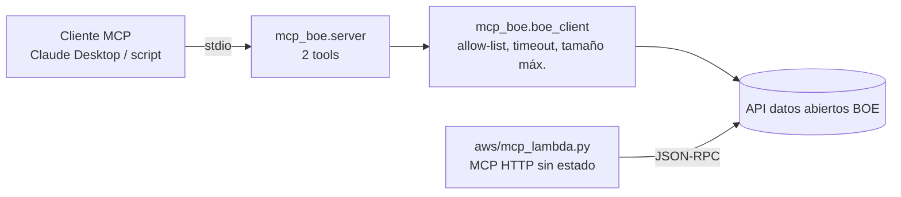

# mcp-servers-demo


Servidor MCP (Model Context Protocol) de demostración que permite a un asistente de IA **consultar y buscar en el sumario diario del BOE** usando su API de datos abiertos. Proyecto personal de portfolio; no está conectado a ningún sistema de ninguna administración.

## Problema
Los LLM citan normas de memoria y se equivocan. MCP permite darles herramientas verificables. Este repo muestra cómo diseñar un servidor MCP **pequeño, seguro y probado**, en local (stdio) y en la nube (AWS Lambda).

## Herramientas expuestas
| Tool | Entrada | Salida |
|---|---|---|
| `sumario_boe` | `fecha` (AAAAMMDD; hoy por defecto) | disposiciones del día: id, título, sección, departamento, epígrafe, URL del PDF y del HTML |
| `buscar_boe` | `texto`, `dias` (≤14), `desde`, `limite` (≤50) | disposiciones cuyo título contiene todas las palabras (sin distinguir acentos ni mayúsculas) en los últimos `dias` sumarios |

## Arquitectura


## Ejecutar
```bash
git clone https://github.com/davidsilvente-dev/mcp-servers-demo && cd mcp-servers-demo
pip install -e ".[dev]"
python -m mcp_boe.server            # transporte stdio
mcp dev src/mcp_boe/server.py       # inspector de MCP
python examples/cliente_stdio.py    # cliente de prueba (usa la API real)
ruff check . && pytest              # lint y 19 pruebas sin red (respuesta grabada en tests/fixtures)
```
Configuración para Claude Desktop en `examples/claude_desktop_config.json`.

Requiere `mcp` 1.x (`mcp<2`): la versión 2 renombró `FastMCP` a `MCPServer`; la migración está en la lista de pendientes.

## Despliegue en AWS (Lambda)
La carpeta `aws/` contiene el mismo servidor como **MCP HTTP sin estado** en AWS Lambda, desplegado con CloudFormation:
- `aws/mcp_lambda.py`: código legible (JSON-RPC: `initialize`, `ping`, `tools/list`, `tools/call`; sin dependencias).
- `aws/boe-mcp.yaml`: plantilla (Lambda de 128 MB, logs a 7 días, URL de función con autenticación **IAM**; no es pública).

```bash
aws cloudformation deploy --template-file aws/boe-mcp.yaml --stack-name boe-mcp --capabilities CAPABILITY_IAM
aws cloudformation delete-stack --stack-name boe-mcp   # retirar todo
```
**Probado el 01/11/2026** en una cuenta de pruebas (eu-west-1) con peticiones firmadas con SigV4: `tools/list` y `tools/call` devolvieron el sumario del 30/10 (74 disposiciones); sin firma, la URL responde 403. La versión Lambda expone solo `sumario_boe`.

## Resultados (medidos el 01/11/2026)
- Sumario del 30/10/2026: 74 disposiciones por stdio y por Lambda.
- `buscar_boe("real decreto", dias=5)`: 5 resultados de dos sumarios (31/10 y 30/10) con la API real.
- `pytest`: 19 pruebas sin red en 0,7 s (cliente, parseo, filtro y servidor MCP en memoria).

## Seguridad
Solo lectura; solo `https://www.boe.es/`; timeout de 10 s; respuesta máxima de 5 MB; sin secretos en el repo. Ver `SECURITY.md`.

## Limitaciones
- Depende de la disponibilidad y el formato de la API del BOE (puede cambiar).
- `buscar_boe` solo busca en los títulos del sumario, no en el texto de las normas; hace una petición por día.
- La versión Lambda no está probada con un cliente MCP completo (haría falta un proxy que firme con SigV4).
- No es un servidor de producción: sin caché, sin limitación por usuario.

## Pendiente
1. Migrar a MCP v2 (`MCPServer`).
2. Herramienta `obtener_norma` (texto consolidado por identificador ELI) y resource `boe://norma/{id}`.
3. Caché de sumarios y bench de latencia.

## Licencia
MIT. Los textos del BOE están sujetos a su [aviso legal](https://www.boe.es/informacion/aviso_legal/).
